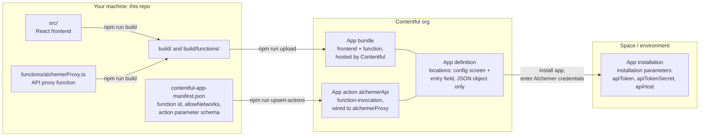
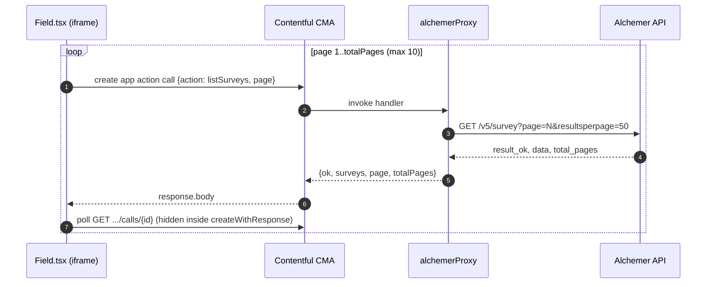
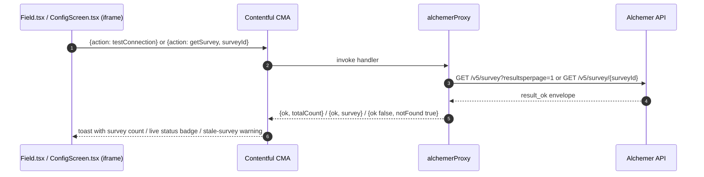

# Alchemer Survey Picker (Contentful app)

A Contentful App Framework app that connects a Contentful space to an Alchemer account.
Editors pick an Alchemer survey directly inside the entry editor — with title filtering, a
live status badge, an inline preview, and deep links to the Alchemer builder — and the app
stores a small survey descriptor in a JSON field. The website then reads that descriptor
via the Delivery API and embeds the survey using Alchemer's standard embed options.

All Alchemer API traffic goes through a read-only proxy function hosted on Contentful's
infrastructure. The browser never sends Alchemer credentials; the function attaches them
server-side from the app's installation parameters. Note that installation parameters are
readable by users of the space (see the trust model under "Caveats and gotchas").

## What the editor experience looks like

- An empty field shows a "Select a survey" button. The picker lists every survey in the
  connected Alchemer account and filters by title as you type; while a large account
  streams in, a progress bar shows how many surveys have loaded so far. Each row carries
  a Select affordance and links a survey to the entry with one click, and a Preview
  button that expands the live survey inline below the row before anything is selected
  (one preview at a time; it uses the share URL already in the list, so previewing costs
  no extra API calls).
- Selecting a survey stores its descriptor in the field and shows a summary card: title,
  survey id, and current status (Launched, Closed, ...), plus buttons to preview the survey
  inline, change or remove the selection, edit the survey in Alchemer, or open its share
  link.
- When an entry is reopened, the app re-checks the saved survey against Alchemer: the badge
  reflects the current status, and a warning appears if the survey was deleted in Alchemer
  after it was selected.

## Contentful concepts used here

A short primer for readers newer to Contentful:

- The [App Framework](https://www.contentful.com/developers/docs/extensibility/app-framework/)
  is how Contentful is extended with custom apps. An app is registered once per
  organization as an **app definition**, then **installed** into individual spaces and
  environments.
- An app's frontend is a set of iframes rendered at **locations** in the Contentful web
  app. This app uses two: the **app configuration screen** (where credentials are entered
  at install time) and the **entry field** location (the survey picker itself).
- **Installation parameters** are per-installation configuration saved when the app is
  installed or reconfigured. This app stores the Alchemer API token, token secret, and
  region there.
- **App functions** are serverless workloads that run on Contentful's infrastructure.
  **App actions** are named, schema-validated entry points that invoke a function through
  the Contentful Management API (CMA). This app ships one function (`alchemerProxy`)
  exposed through one action (`alchemerApi`).
- The project was scaffolded with
  [create-contentful-app](https://github.com/contentful/create-contentful-app), which
  provides the build, upload, and app-definition tooling used below.

## Architecture

### Why there is a proxy function

The Alchemer REST API does not send CORS headers, so a browser cannot call it from the
Contentful iframe. All API traffic therefore goes through the `alchemerProxy` app function,
which runs on Contentful's infrastructure and is exposed as the `alchemerApi` app action.

The proxy is read-only and deliberately not an open proxy:

- Only three operations are supported — `listSurveys`, `getSurvey`, and `testConnection` —
  all HTTP GETs against the Alchemer v5 API. Nothing in the app can create, modify, or
  delete anything in Alchemer.
- Outbound traffic is restricted twice: Contentful enforces the manifest's `allowNetworks`,
  and the function independently refuses any API host not on its allowlist of the four
  Alchemer regional domains.
- Credentials come exclusively from installation parameters, are attached server-side, and
  are never part of a request or response to the browser. Error messages are sanitized so
  the credential-bearing request URL cannot leak into logs or the UI.

Function internals (dispatch, error handling, logging rules) are documented in
`functions/README.md`.

### Deployment pipeline (what the setup below wires together)

Nothing in this repo runs anywhere until it is built and pushed into a Contentful app
definition. `npm run upload` hosts both the frontend and the function on Contentful;
`npm run upsert-actions` creates the app action that the frontend calls the function
through.



### Runtime data flow

Every call detours through the Contentful-hosted function — this is also why local
development still needs the uploaded function: only the frontend runs on your machine.
Every proxy call has the same four-hop shape, entered through `callAlchemer` in
`src/lib/alchemer.ts`. `createWithResponse` hides an async protocol: it POSTs to create
the app action call, then polls the CMA until the result is ready — which is why each
call costs seconds, and why the picker loads everything once instead of calling per
keystroke.

Opening the picker (the one heavy path — repeated once per page of 50 surveys):



After that, typing in the filter box and selecting a survey cost zero proxy calls: titles
are matched in memory, and selection just writes the descriptor into the JSON field.

The two lightweight paths — the config screen's "Test connection" and the staleness check
when an entry with a saved survey is reopened — are single round trips of the same shape:



## The field and what gets stored

The app only accepts **JSON (Object)** fields; assigning it to any other field type shows
an error note instead of the picker. A selected survey is stored as:

```json
{
  "surveyId": "1234567",
  "title": "Customer Satisfaction Q3",
  "status": "Launched",
  "url": "https://survey.alchemer.com/s3/1234567/customer-satisfaction-q3",
  "editUrl": "https://app.alchemer.com/projects/editor?id=1234567",
  "modifiedOn": "2026-07-01 12:00:00",
  "savedAt": "2026-07-27T22:30:00.000Z"
}
```

The delivery side only needs `url` — render it with Alchemer's iframe or JavaScript embed
(https://help.alchemer.com/help/embed-a-survey-on-your-website). The embed choice affects
theming: the iframe embed preserves the survey's theme and custom CSS, while the
JavaScript embed inherits the site's styles (see the preview/styling caveat below). The
rest of the stored value exists so the editor UI can render without an API round trip.

The editor treats the stored value as untrusted input, because a JSON field can be written
by anything with Management API access, not only this app. A value without a string
`surveyId` and `title` is reported as unrecognized (with Remove and Select buttons)
instead of being rendered. `url` and `editUrl` are only rendered as links or loaded in
the preview iframe when they are `https` URLs on an Alchemer domain (`alchemer.com`,
`alchemer.eu`, `alchemer-ca.com`, including subdomains such as `survey.` and `app.`);
otherwise the card shows a warning and hides those controls. Both preview iframes are
sandboxed so a framed page cannot navigate the Contentful tab. Share links on an
Alchemer private/custom domain are therefore not previewable in the editor (unverified:
whether the v5 API returns such links as `links.default`); the stored `url` is unchanged
and still works on the delivery side.

## Caveats and gotchas (read before setup)

- The field editor and the config screen's test button DO NOT WORK until the function
  bundle is uploaded and the app action exists (setup steps 3 and 4 below). Only the
  frontend can run locally; the proxy always runs on Contentful.
- Alchemer API credentials are stored as app installation parameters, which are readable
  by users of the space. Use a dedicated Alchemer API key with the least privileges
  possible, generated under a service user rather than a personal account (Alchemer keys
  are per user). Rotation gotcha: regenerating a key invalidates the old one immediately —
  all calls return 401 until the config screen is updated and saved.
- Trust model: the proxy does not check who is calling. Any Management API token with
  access to the space can invoke the `alchemerApi` app action (the curl recipe under
  "Testing the deployed function" shows how) and list every survey the configured
  Alchemer key can see: titles, statuses, share links and editor links, but nothing
  else — the proxy is read-only and returns no response data. Scope what is exposed on
  the Alchemer side: give the service user only the teams/surveys that should be
  pickable. Per-Contentful-user restrictions would need the function to check the
  caller's identity and are not implemented.
- Authentication uses `api_token` + `api_token_secret`. Alchemer's only alternative is
  OAuth 1.0 (there is no OAuth 2.0), which is scoped to the authorizing user and would
  need a callback hosted outside the Contentful iframe, so it is not used here.
- Alchemer is region-sharded. The API host is an installation parameter, the function
  allows exactly the four documented regional domains (US, EU, Canada, Australia — see
  https://apihelp.alchemer.com/help/api-base-domains), and a wrong region surfaces as an
  auth failure (HTTP 401), not a clear "wrong region" error. An absent host (installs
  saved before the region picker existed) means the US default; a stored host that is
  not on the list is reported as an error rather than silently swapped for the default.
- On a 401/403 the function appends Alchemer's own `message` to the error, because the
  cause is not always the key. Any Alchemer message is scrubbed of the token and secret
  before it is shown or logged (`functions/alchemerProxy.spec.ts` covers this). Seen 2026-10-29: a brand-new key returned 403 "You must
  verify your email before you can access the API." until the Alchemer user who generated
  it verified their email address. A wrong region instead reads "Invalid api_token or
  api_token_secret supplied".
- Alchemer rate limits are account-wide: 240 requests/minute shared across every API
  consumer on the account (https://apihelp.alchemer.com/help/api-request-limits), plus a
  separate 429 when an identical request is already in flight — which two editors opening
  the picker at the same time can trigger. The proxy flags 429s and the picker retries the
  failed page in place (2 retries, 20 s apart) while keeping already-loaded pages visible.
  The app's own traffic (sequential pages, seconds per round trip) cannot realistically
  exhaust the budget by itself.
- Alchemer caches identical GET requests for 60 seconds, so a survey renamed in Alchemer
  can take up to a minute to update in the picker.
- Title search is entirely client-side: the v5 filter grammar
  (https://apihelp.alchemer.com/help/filters-v5) has no substring operator, and routing a
  search through the proxy costs seconds per keystroke. The picker instead loads the full
  survey list once when opened (pages of 50, capped at 500 surveys with a "showing the
  first 500" notice beyond that) and filters titles in memory. Refresh re-fetches. If the
  very first page fails, the picker does not retry on its own; the error note plus the
  Refresh link is the retry path (an automatic retry here would loop against the API).
- Alchemer folders/subfolders cannot be shown in the picker: they are a UI-only feature of
  the Alchemer web app with no object, endpoint, or survey field in the REST API v5. The
  only grouping the API exposes is Teams. Findability inside the picker is the title
  filter.
- The config screen's "Test connection" button uses the last SAVED parameters, not unsaved
  form edits. Save first, then test.
- Alchemer surveys have two titles: the respondent-facing `title` (defaults to "Alchemer
  Survey" and drives the share-link slug) and `internal_title`, the project name shown in
  Alchemer's survey list. The list endpoint returns only `title` but fills it with the
  internal title; the single-survey endpoint returns both. The proxy prefers
  `internal_title` so the picker and the saved value always show the name editors know
  from Alchemer. Changing the public title inside a survey does not change what the
  picker shows.
- The editor previews (inline in the picker and on the selected-survey card) iframe the
  survey's share link, so they always show the full Alchemer theme including any custom
  CSS — the same appearance as Alchemer's iframe embed. If the delivery site uses the
  JavaScript embed instead, the survey renders in the page's own DOM and inherits the
  site's styles (entirely so with its "Do not include theme styles" option), so the
  preview reflects the survey's content and flow but not necessarily its production
  styling. Related gotcha for custom CSS on surveys: with the JavaScript embed the
  theme's custom CSS shares one cascade with the site's stylesheets, so rules can be
  overridden by site CSS — and broadly scoped selectors (`body`, `h1`, `input`) can leak
  out and restyle the host page. Scope custom CSS tightly and test on the real page.

## Setup from scratch

Prerequisites: a Contentful organization you can create apps in, an Alchemer account with
an API key, Node.js 18+ (22.18+ to use the local test harness), and npm.

### 1. Create the app definition

There are two ways to do this; both end in the same app definition.

**Option A — Contentful web app.** In the Contentful web app, open your organization
settings (account menu in the top navigation), go to the Apps section, click
"Create App", and set:

- Frontend URL: leave empty if using `npm run upload` below (which hosts the frontend on
  Contentful), or `http://localhost:3000` during development.
- Locations: check "App configuration screen" and "Entry field", and under Entry field
  check only "JSON object".

**Option B — CLI.** Run `npm run create-app-definition`, which prompts for the same
choices and can write the `.env` file from the next step for you.

### 2. Environment file

Copy `.env.example` to `.env` in this directory and fill in the values (used by the upload
and action scripts, not by the app at runtime; `.env` is gitignored):

```bash
cp .env.example .env
```

```env
CONTENTFUL_ORG_ID=your-organization-id
CONTENTFUL_APP_DEF_ID=your-app-definition-id
CONTENTFUL_ACCESS_TOKEN=your-cma-personal-access-token
```

The example file also lists the `ALCHEMER_*` variables, which only the local harnesses
under "Testing the function locally" read.

### 3. Build, upload the bundle, create the app action

```bash
npm install
npm run build
npm run upload
npm run upsert-actions
```

`upload` bundles the frontend and the function and activates the bundle (`upload-ci` is
the non-interactive variant driven by the `.env` variables). `upsert-actions`
creates/updates the `alchemerApi` app action from `contentful-app-manifest.json`; the
field editor calls the API through that action, so this step is not optional.

### 4. Install and connect

1. Install the app into the space/environment. The configuration screen asks for the
   Alchemer API token, token secret, and region. Alchemer keys live under Account >
   Integrations > API Key (admins: Security > API Access).
2. Save, then use "Test connection" to verify credentials end to end.
3. In the content model, add or open a JSON object field, and on the field's Appearance
   tab select this app.

## Local development

```bash
npm start
```

Runs the frontend on http://localhost:3000 (set that as the app definition's frontend URL
while developing). The proxy function always runs on Contentful's infrastructure, not
locally — API calls from a locally served frontend still require the uploaded function and
app action from setup step 3.

## Testing the function locally (isolated harness)

`scripts/test-proxy.mts` imports the real `handler` from `functions/alchemerProxy.ts` and
calls it directly on your machine with a synthetic event/context, hitting the live
Alchemer API — no bundle upload, no app installation, no CMA round trip.

Caveats first:

- This is NOT an end-to-end test. It bypasses Contentful's parameter-schema validation
  (from `contentful-app-manifest.json`), the function sandbox's `allowNetworks` egress
  restriction, and real installation parameters. A run that passes here can still fail in
  Contentful if the manifest/action wiring is wrong — use "Testing the deployed function"
  below for that.
- Credentials come from `ALCHEMER_API_TOKEN` / `ALCHEMER_API_TOKEN_SECRET` (and optional
  `ALCHEMER_API_HOST`, default `api.alchemer.com`), read from the environment or from
  `.env`. `.env` is gitignored, so it is safe to add them there alongside the Contentful
  variables.
- Requires Node >= 22.18 (built-in TypeScript type stripping; no build step). On this
  repo's typeless package.json, Node emits a `MODULE_TYPELESS_PACKAGE_JSON` warning; the
  commands below silence it with `--disable-warning` rather than adding `"type": "module"`
  to package.json, which could affect the vite/app-scripts builds.
- Running with missing/dummy credentials is deliberately allowed so the handler's own
  error paths stay testable; the script warns and exits 2 on any `ok: false` result.

```bash
node --disable-warning=MODULE_TYPELESS_PACKAGE_JSON scripts/test-proxy.mts testConnection
node --disable-warning=MODULE_TYPELESS_PACKAGE_JSON scripts/test-proxy.mts listSurveys 1
node --disable-warning=MODULE_TYPELESS_PACKAGE_JSON scripts/test-proxy.mts getSurvey 1234567
```

Or via npm (note the `--` before arguments):

```bash
npm run test:proxy -- testConnection
```

The script prints the handler's own request/response logging (URLs credential-redacted)
followed by the JSON result the frontend would receive.

## Checking Alchemer API latency

When survey loading feels slow, `scripts/bench-alchemer.mts` answers "is it Alchemer?"
in one command: it times the exact three API calls the app makes with plain fetch —
no proxy handler, no Contentful — so slow numbers here mean the Alchemer API itself is
slow. Calls at 2000ms or more are flagged SLOW.

Caveat: Alchemer serves identical GETs from a 60-second cache, so a second run within a
minute measures the cache, not the API. Wait a minute between runs.

```bash
npm run bench:alchemer
node --disable-warning=MODULE_TYPELESS_PACKAGE_JSON scripts/bench-alchemer.mts 1234567
```

The optional argument is a survey id for the getSurvey timing; without it, the first
survey from the list call is used. Credentials come from the same `ALCHEMER_API_TOKEN` /
`ALCHEMER_API_TOKEN_SECRET` (and optional `ALCHEMER_API_HOST`) as the local harness
above. Example output:

```
Alchemer API latency check against api.alchemer.com

testConnection    GET /v5/survey?resultsperpage=1                200    2645ms  SLOW
listSurveys       GET /v5/survey?resultsperpage=50&page=1        200     691ms    9 surveys, 1 page(s)
getSurvey         GET /v5/survey/1234567                         200     347ms

At least one call took 2000ms or more - the Alchemer API is the bottleneck.
```

To see where a slow editor experience is spent end to end, compare these numbers with
the deployed function's log timings (`alchemer response: HTTP 200 in Nms`) and the total
wall-clock the picker reports: raw API time (this script) vs function time (logs) vs
CMA app-action overhead (the remainder).

## Testing the deployed function

Gotcha first: app action calls are scoped to an app INSTALLATION, so they 404 (and the UI
shows the "could not invoke the proxy function" error) until the app is installed in the
target environment — installing is also what saves the credentials, since the config
screen's save handler runs on install.

To invoke the action from the CLI without the UI, set `SPACE_ID` to the space the app is
installed in (Contentful web app: Settings > General settings) and `ENVIRONMENT_ID` to the
environment. The environment matters: calls run against that environment's installation
and therefore its saved credentials.

```bash
set -a; source .env; set +a
SPACE_ID=your-space-id
ENVIRONMENT_ID=master
curl -s -X POST \
  "https://api.contentful.com/spaces/$SPACE_ID/environments/$ENVIRONMENT_ID/app_installations/$CONTENTFUL_APP_DEF_ID/actions/alchemerApi/calls" \
  -H "Authorization: Bearer $CONTENTFUL_ACCESS_TOKEN" \
  -H "Content-Type: application/vnd.contentful.management.v1+json" \
  -d '{"parameters":{"action":"testConnection"}}'
```

The call is asynchronous; take `sys.id` from the response and poll for the result:

```bash
curl -s "https://api.contentful.com/spaces/$SPACE_ID/environments/$ENVIRONMENT_ID/actions/alchemerApi/calls/CALL_ID_HERE" \
  -H "Authorization: Bearer $CONTENTFUL_ACCESS_TOKEN"
```

`response.body` holds the function's JSON (e.g. `{"ok":true,"totalCount":4}`). Other
useful payloads: `{"parameters":{"action":"listSurveys","page":1}}` and
`{"parameters":{"action":"getSurvey","surveyId":"1234567"}}`.

Function logs (every invocation, with console output and errors) live in the Contentful
web app under organization settings > Apps > [app name] > Functions > alchemerProxy >
Logs.

## Project layout

- `functions/alchemerProxy.ts` — app-action function proxying `listSurveys` / `getSurvey` /
  `testConnection` to the Alchemer REST API v5 (docs: https://apihelp.alchemer.com/help/v5).
  It has no search operation — title filtering is client-side in the picker (see caveats).
  Deliberately not an open proxy: only those three operations are supported, the API host
  must be on the region allowlist (otherwise the stored-but-editor-visible host parameter
  could redirect requests and leak the token), and fetch errors are never echoed verbatim
  because the credentials ride in the request URL's query parameters. Internals (dispatch,
  error ladder, logging rules, why there is no search) live in `functions/README.md`.
- `contentful-app-manifest.json` — declares the function (including `allowNetworks` for the
  four Alchemer regional hosts) and the `alchemerApi` app action with its parameter schema.
  The action id is mirrored in `src/lib/alchemer.ts` (`APP_ACTION_ID`).
- `src/lib/alchemer.ts` — frontend helper that invokes the app action via the CMA and parses
  the response; also defines the `SavedSurvey` field value shape, `parseSavedSurvey`
  (validates a stored value) and `safeAlchemerUrl` (https + Alchemer domain allowlist for
  links and previews). Tests in `src/lib/alchemer.spec.ts`.
- `src/locations/Field.tsx` — the JSON field editor: empty state, searchable paginated picker,
  selected-survey card with sandboxed preview iframe, a stale-survey warning when the saved
  survey was deleted in Alchemer, and warnings for unrecognized values or non-Alchemer URLs.
- `src/locations/ConfigScreen.tsx` — installation parameters (token, secret, region) plus the
  test-connection button.
- `scripts/test-proxy.mts` — local harness that runs the function handler directly (see
  "Testing the function locally").
- `docs/ADRs/` — architectural decision records: why a proxy function, why API token auth
  rather than OAuth, why the picker searches client-side, why 429 retries live in the
  browser.
- `AGENTS.md` — the maintainer's guide: invariants, lists that must stay in sync by hand,
  and commands. `CLAUDE.md` just imports it.

## Scripts

- `npm start` — Vite dev server for the frontend (`npm run dev` is an alias).
- `npm run build` — type-checks both trees, then builds the frontend to `build/` and the
  function to `build/functions/` (the function step alone is `npm run build:functions`).
  Vite and vitest never type-check on their own, which is why `tsc` runs here.
- `npm run typecheck` — `tsc --noEmit` for `src/` and for `functions/` (separate tsconfigs).
- `npm run lint` / `npm run lint:fix` — ESLint (flat config in `eslint.config.mts`); `lint`
  fails on warnings as well as errors.
- `npm run install-ci` — `npm ci`, the install convention used by Contentful's app
  monorepos. `package.json` carries an `overrides` entry pinning `@contentful/app-sdk`'s nested
  `contentful-management` to 12.18.0, the last release that installs on Node 20 (newer ones
  need `contentful-sdk-core` 10, which requires Node 22). Remove it when the hosting repo's CI
  moves to Node 22.
- `npm run preview` — serves the already-built `build/` frontend locally.
- `npm run test` / `npm run test:ci` — vitest (watch / single run).
- `npm run test:proxy -- <action> [arg]` — runs `functions/alchemerProxy.ts` locally against
  the live Alchemer API (see "Testing the function locally").
- `npm run bench:alchemer` — times the raw Alchemer API calls the app makes and flags slow
  ones (see "Checking Alchemer API latency").
- `npm run upload` — interactive bundle upload and activation.
- `npm run upload-ci` — same, driven by the `.env` variables above.
- `npm run upsert-actions` — creates/updates app actions from the manifest (needs `.env`).
- `npm run create-app-definition` — alternative to creating the app definition in the web UI.
- `npm run add-locations` — interactive helper to add locations to an existing app definition.

## License

MIT, see `LICENSE`.
