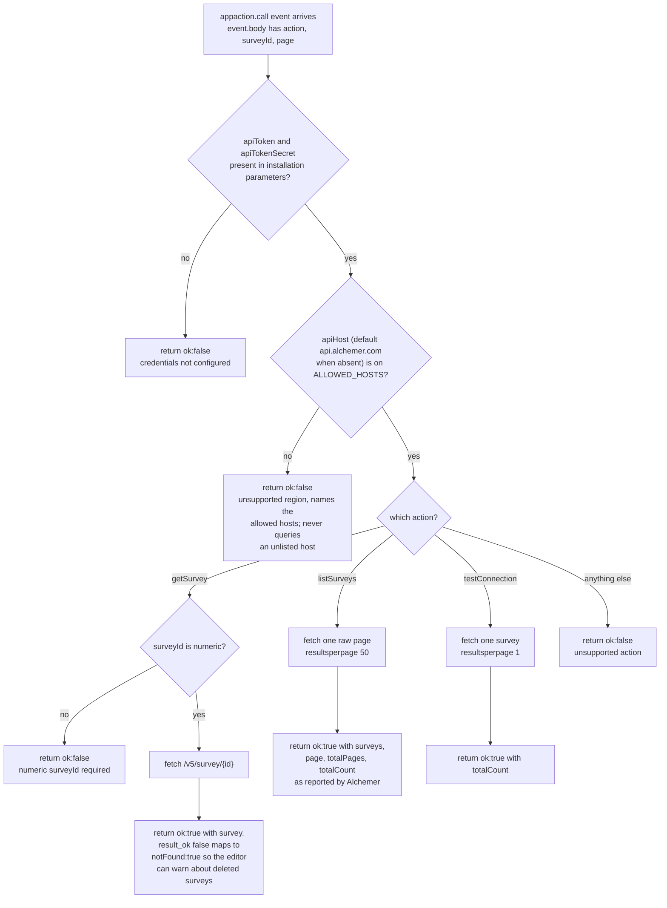
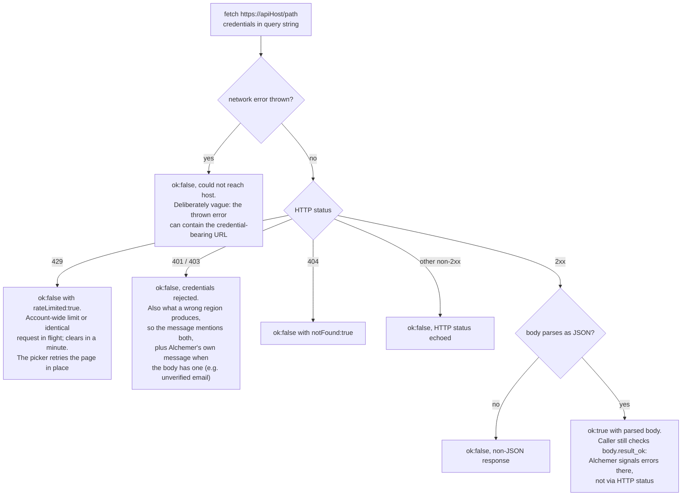

# alchemerProxy function internals

This documents the logic inside `alchemerProxy.ts`, the app-action function that proxies
the browser's Alchemer calls. For the outer picture — why the proxy exists (Alchemer sends
no CORS headers), how the bundle is deployed, and the browser-to-Alchemer sequence — see
the Architecture section of the project README. To run this handler locally against the
live Alchemer API without deploying, see "Testing the function locally" there too.

## Runtime constraints that shaped the code

- The function runs in Contentful's sandbox, not full Node.js. Node's `http`/`https`
  modules do not exist there; the one supported way to make outbound requests is the
  global `fetch` API, and `alchemerProxy.ts` uses nothing else. Any future dependency
  added to the function must do its I/O via `fetch` too (Node-build `axios` would break).
- Outbound traffic is restricted twice: Contentful enforces the manifest's
  `allowNetworks`, and the code independently refuses any stored host not in
  `ALLOWED_HOSTS`. The second check matters because `apiHost` is editor-visible
  installation config; without it a tampered host would receive the credentials.
- Alchemer credentials arrive via `context.appInstallationParameters`, never from the
  browser, and are appended to the request query string — which is why error messages
  are sanitized (a raw fetch error can contain the full URL).

## Handler dispatch



Every fetch above goes through the shared `alchemerGet` helper, whose error ladder is:



## Why there is no search parameter

Two dead ends, both preserved here so they are not retried. The original design used
Alchemer's list filter with a `contains` operator — which does not exist; the v5 filter
grammar has no substring operator at all. The second design scanned pages inside the
function and filtered titles there, which worked but was unusably slow: every app-action
round trip (browser to CMA to function to Alchemer and back) costs seconds, and search
paid it per keystroke. Since 2026-08-14 the frontend loads the full survey list once via
plain page-based `listSurveys` calls (capped at 10 pages / 500 surveys) and filters
titles in memory, so search costs nothing after the initial load.

## Logging

Every invocation logs its full in/out contents, viewable in the web app under
organization settings > Apps > Alchemer > Functions > alchemerProxy > Logs, or via
the CMA (`GET /organizations/{org}/app_definitions/{app}/functions/alchemerProxy/logs`,
then fetch a single log id for the messages). A one-page list request produces:

```
request parameters: {"action":"listSurveys","page":1}
alchemer request: GET https://api.alchemer.com/v5/survey?api_token=REDACTED&api_token_secret=REDACTED&resultsperpage=50&page=1
alchemer response: HTTP 200 in 4276ms
alchemer response summary: {"result_ok":true,"page":1,"total_pages":1,"total_count":2,"data_items":2}
function result (4279ms): {"ok":true,"surveys":[...],"page":1,"totalPages":1,"totalCount":2}
```

The two durations bracket where time goes: "HTTP ... in Nms" is the Alchemer round trip
alone, and "function result (Nms)" is the whole handler, so the difference is this
function's own overhead (typically single-digit ms). What the editor experiences on top
of that is the CMA app-action create/poll protocol, which is not measurable from inside
the function. A failed fetch logs "alchemer request failed after Nms" instead.

Two extra log lines appear only when relevant: `alchemer X-SG-Warning: ...` whenever
Alchemer sends its approaching-rate-limit warning header (worth watching for on a busy
shared account), and `alchemer 429 message: ...` with Alchemer's own throttle message
when a request is actually rejected.

Ground rules baked into the code: outbound URLs are only ever logged through
`redactedUrl` (token parameters masked — logs are visible to the whole org), any
`message` Alchemer returns is passed through `redactSecrets` before it is logged or
returned to the editor (Alchemer has never been seen to echo credentials, but its message
catalogue is undocumented, so this is not assumed), the raw
Alchemer body is summarized rather than dumped, and every logged JSON payload is
truncated at `LOG_MAX_CHARS` (2000) so a 50-survey page cannot flood the log. The
exported `handler` is a thin wrapper that logs `event.body` and the result around
`run()`, which holds the real logic — one log point covers every return path.

## Return shape

All paths return `{ ok: true, ... }` or `{ ok: false, error, notFound?, rateLimited? }` — the
`AlchemerResult` union mirrored in `src/lib/alchemer.ts` (kept as a deliberate copy:
the functions tree builds independently, so sharing a module would couple the two
builds). Contentful JSON-serializes the returned object into the app action call's
`response.body`, where the frontend parses and re-validates it.
